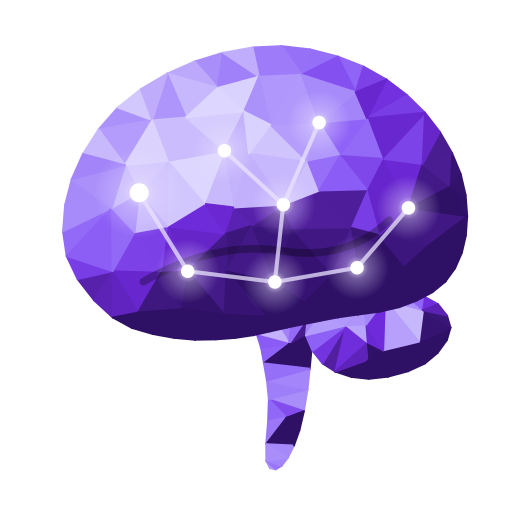

<p align="center"></p>

<h1 align="center">Brainiac</h1>

<p align="center">Your Obsidian vault as a glowing 3D brain.</p>

See your whole vault as a glowing 3D brain. Every note is a bright dot, and every paragraph inside it is a smaller dot next to it, so a vault with 2,000 notes becomes a brain of 100,000+ points you can spin, search and replay over time.

Desktop only.

## What you get

- **Anatomy**: a brain with two hemispheres, a spine and nerves. Each folder gets a share of the cortex in proportion to how much it holds, and notes about similar things sit next to each other.
- **11 more forms**, and the dots fly between them:
  - **Galaxy**: a free cloud where similar notes float together.
  - **Spheres**: one ball per folder.
  - **Clusters**: balls by topic instead of folder, named after the most telling word in their titles.
  - **Shells**: one shell per folder.
  - **Wheel**: one slice per folder, with older notes in the middle.
  - **Ribbon**: folders against months.
  - **Lifelines**: each folder's first-to-last date.
  - **Stream**: how much you wrote, stacked by folder.
  - **Folders**: boxes sized by folder.
  - **Calendar**: every day you wrote, plus your longest streak.
  - **Clock**: what hour you write.
- **Timeline**: press play and the brain grows note by note in date order. Oldest or newest first.
- **When you wrote**: a bar chart of dots per month. Click a month to light up just those notes.
- **Folder trail**: click a folder in the legend or on a label. A coloured path runs through its notes from oldest to newest, and a side panel lists them.
- **Search, hover and click**: hovering shows a note's title, the heading of the paragraph under your cursor, the folder and the date. Clicking opens the note at that heading.
- **Looks**: 7 data colour palettes, 4 background themes, glow, links between notes, auto-rotate and point size.

## How it works

Notes are compared by their words with TF-IDF, which is built in and needs no setup. They're then laid out in 3D with UMAP and snapped into the shape of the current form. Everything runs locally inside Obsidian. The layout is cached in the plugin's data file, so it only recomputes when you ask it to or when a lot of your vault changes.

Open it from the brain icon in the ribbon or with the **Open brain view** command. Settings are in the ☰ panel inside the view.

## Privacy and disclosures

- **No telemetry, no accounts, no payments.**
- **Network use (optional, off by default)**: if you set *Similarity* to *Ollama embeddings*, Brainiac sends your note text to an [Ollama](https://ollama.com) server at `http://localhost:11434`. That server runs on your own computer and is used to get better topic grouping. Brainiac makes no other network requests.
- **Files outside your vault (optional, off by default)**: if you turn on *Claude Code chats*, Brainiac reads your [Claude Code](https://www.anthropic.com/claude-code) history from `~/.claude/projects/*.jsonl`. Each chat becomes a dot running down the spine, and each message you typed becomes a smaller dot. These files are only read, never changed, and nothing is sent anywhere. Clicking a chat copies `claude --resume <id>` to your clipboard.
- **What's shown**: tooltips show note titles, paragraph headings, folder names and dates, never paragraph text.
- **Skipped files**: files whose names contain words like "API key", "token", "password", "secret" or "credential" are skipped. You can exclude more folders in the plugin's data file (`excluded`, comma-separated paths).

## Install

From Obsidian: **Settings → Community plugins → Browse**, then search for "Brainiac".

Manually: download `main.js`, `manifest.json` and `styles.css` from the [latest release](https://github.com/lukejacobsen7/brainiac/releases/latest). Put them in `<vault>/.obsidian/plugins/brainiac/`, then enable Brainiac under **Community plugins**.

## Build

```
npm install
npm run build
```

## Credits

- [three.js](https://threejs.org) (MIT) for rendering.
- [umap-js](https://github.com/PAIR-code/umap-js) (Apache-2.0) for the 3D layout.

Inspired by the [mindcorpus](https://www.mindcorpus.org) app. No code is shared with it.

## License

MIT
